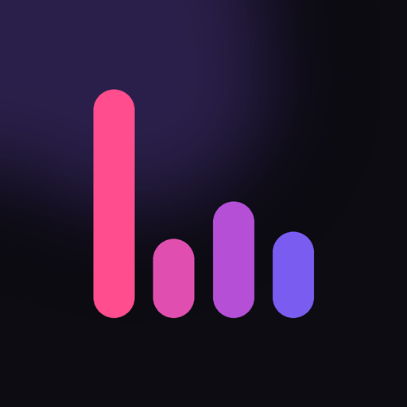

# Lyra

**A free, ad-free music app for Android and iPhone.**
Fast, refined, and completely free of ads.

[**Download**](https://github.com/walldrop4k-hub/lyra-app/releases/latest) ·
[Website](https://walldrop4k-hub.github.io/lyra-app/) ·
[Instagram](https://instagram.com/filesofsaad)

---

## Screenshots

<!-- Add phone screenshots to the screenshots/ folder and list them here, e.g.:

  
  
  

-->

_Coming soon._

## Features

- 🎧 **Millions of songs:** Bollywood, Punjabi, Pakistani, Hollywood and indie, up to 320 kbps
- 🔀 **Spotify-style crossfade** and gapless playback, even with the phone locked
- 🎤 **Word-by-word lyrics** that glow as they're sung, with Roman letters for Hindi and Punjabi
- ⬇️ **Offline downloads** kept inside the app, plus auto-download of liked songs
- 🏠 **Made for You:** Daily Mixes, On Repeat, and your own Lyra Wrapped
- 🔎 **Smart search** that puts the song you mean first
- 🎨 **Make it yours:** 7 themes, accent colours, pure black, glass transparency, lyric fonts, text size and app icons
- 😴 Sleep timer, equalizer (Android), queue in Spotify order, share songs and playlists by link or QR code
- 🚫 **No ads, no account, no tracking.** Your profile stays on your phone.

## Install

**Android**
1. Download `Lyra-<version>.apk` from the [latest release](https://github.com/walldrop4k-hub/lyra-app/releases/latest).
2. Open it and allow "Install unknown apps" when asked.
3. New versions install over the old one; your library and downloads stay.

**iPhone**
1. Download `Lyra-<version>.ipa` from the [latest release](https://github.com/walldrop4k-hub/lyra-app/releases/latest).
2. Install it with [Sideloadly](https://sideloadly.io) (or SideStore / AltStore) using your Apple ID.
3. With a free Apple ID the app needs re-signing every 7 days.

## About

Crafted and developed by **Muhammad Saad**, a designer and creative technologist
based in Pakistan. He builds seamless digital experiences across UI/UX, web, and
mobile platforms. Lyra is his vision of what a music app should feel like: fast,
refined, and completely free of ads.

Instagram: [@filesofsaad](https://instagram.com/filesofsaad)

---

Lyra is a personal, non-commercial project. Music, artwork and lyrics belong to their owners
and come from public sources (JioSaavn, Audiomack, SoundCloud, Apple Music, LRCLIB).
The app's source code is private.
